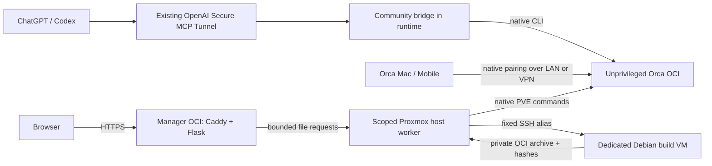

# Architecture and evidence

Updated 17 November 2026. The original mandate remains in [PROJECT_BRIEF.md](PROJECT_BRIEF.md).
The UI and operational text default to English.

## Boundaries

The manager has no shell, agent-dispatch or general Proxmox API endpoint. Its
unprivileged Flask process writes fixed `refresh`, `update`, `update_opencode`, `rollback`, `pair_web`,
`login_github`, `login_gitlab` and `forgejo_key` requests
with a fixed schema. The root-owned parent of the queue prevents replacing the
status/results paths. The host worker claims requests into a private directory,
rejects links, non-regular or oversized files, validates every field and checks
the deployment generation. It verifies ownership markers before stopping a
container or starting the assigned builder. No Docker socket, host network,
privileged container or host shell is exposed to the UI.

The worker's root privileges are real: it imports OCI archives, stops/starts only
scoped guests, owns backups and binds their data. Keep its checkout/configuration
administrator-owned. The installation is for one trusted operator, not multiple
untrusted tenants. The manager guest runs its HTTPS entrypoint as mapped guest
root and drops Flask to UID 1000. The runtime and agents run as UID 1000. All
native CTs are unprivileged. Docker trial capabilities are reduced to the three
needed for manager file ownership and dropping UID/GID; the runtime drops all.

Manager data, runtime HOME and workspaces are explicit separate mounts. Provider
credentials and pairing state stay in runtime HOME. The manager cannot read it.
Browser pairing uses Orca's fixed native CLI command, never direct profile reads.

The standard image ships the official OpenCode 2 binary as `opencode2`.
Orca launches it with `--standalone` and recognizes OpenCode 1 as a separate
agent. Native `settings.get` and `settings.update` use the runtime user's
authenticated local socket and change only `defaultTuiAgent`. A private record
identifies the previous manager-selected agent so an upgrade can migrate that
default while honoring the user's own choice. The WebUI keeps a browser-local
default. [Orca agent catalog](https://github.com/stablyai/orca/blob/v1.4.261/src/shared/agent-launch/catalog/tui-agent-config.ts)

SQLite persists the Git, launch and completed setup stages. After sign-in,
the manager asks the scoped worker to start a fixed native `gh` or `glab`
device authorization as the Orca user. While the operator visits the provider,
the CLI polls the provider in the guest and the worker can process other jobs.
Only a validated human-entered code reaches the authenticated initiating session
through the private offer directory. Attempts expire after ten minutes. The CLI
stores the final credential in persistent runtime HOME. The Forgejo action
returns an Ed25519 public key. Its instance address stays in the browser and
the operator registers the key at their own instance.

An authenticated CSRF-protected POST requests browser pairing. The worker checks
the assigned manager/runtime, deployment generation and request age, and invokes
`orca pair --address wss://MANAGER-ORIGIN/orca --json` as the runtime user. The
origin comes from a mapped-root-owned descriptor written by the manager's
supervisor, not request headers or browser-supplied fields. The worker validates
Orca's endpoint and original browser fragment, then forwards the native URL
unchanged. Orca's original frontend performs pairing; no second protocol exists.

Credentials never enter public status or ordinary job results. A separate
root-owned `control/pairings` directory uses mode 02710 and mapped manager group
101000, with files mode 0640. Only the requesting authenticated browser session
can retrieve its result through the manager. Responses are uncached; credential
JSON omits referrers and HTML preserves only same-origin referrers for strict
CSRF checks. Native offers travel only in fragments, never HTTP referrers.
Private copies expire after two minutes and are pruned by the worker;
a changed deployment generation invalidates them. New-tab progress redirects to
Orca's fragment URL, while the details page offers URL/code copying and native
manual instructions. Link readiness never implies a connected browser.
A root-owned dedicated data filesystem contains queue, images, runtime data and
backups; large image/backup files do not land on the Proxmox host root filesystem.

Proxmox extracts OCI images as mapped root (host UID 100000), so it cannot read
root-only private archives directly. Each import uses a temporary image copy in
an administrator-owned directory with no listing permission, readable only by
that mapped UID (mode 0400). The copy is removed after success or failure; the
private profile and backup tree remain inaccessible to the extractor.
The manager's bind-mount parent permits traversal to its UID-1000 application
directory; TLS keys remain in a separate root-only subdirectory. Sanitized status
files explicitly receive their intended readable mode despite the worker's
private default umask. Native probes use absolute administrative executable paths.

For first administrator setup, the worker copies only the one-time code to the
assigned manager container's Proxmox Summary Notes. It validates the mapped-owner
private file without following guest-controlled links and bounds its size/format.
A locked compare-and-set preserves unrelated Notes and the exact ownership marker;
the code travels through a local stdin pipe, never argv, logs or status snapshots.
Once consumed, its Notes copy is removed on the next worker pass. This deliberately
allows readers of that container's Proxmox configuration to use a pending code.

## Version changes

Orca release labels, tags and pre-release flags are read from
[official releases](https://github.com/stablyai/orca/releases). There is no local
stable/approved/tested list. Missing server archives or published checksums are
shown as technical limitations. Public metadata/downloads need no runtime GitHub
login. The builder records the official archive digest, clean manager source
commit and exported OCI archive digests. It does not publish images.

The release selector offers upgrades only, using numeric version and SemVer
pre-release ordering. Cached metadata is filtered against the current installed
version on every view. Both the queue controller and host worker reject equal or
older versions. Older software is available only through a saved rollback point.

OpenCode metadata comes independently from [its official releases](https://github.com/anomalyco/opencode/releases).
The fixed `update_opencode` action selects only the provider version, preserving
Orca; an Orca update preserves the observed OpenCode version. The package SHA-256
and version are included in the private image manifest and checked by the host
before import. Both catalogs share the operation lock, downgrade guards and data
return process. An unknown installed provider version blocks a change; startup
success requires native RPC and both selected version numbers.

A version change builds and creates the stopped replacement first. It checks
live terminal activity again, gracefully stops the old runtime, copies the
consistent HOME/workspace group, records the return point, then starts the new
container. It never restores data automatically. The user tries the release in
Orca. A failed start retains the previous container and data backup. Failed
backup attempts bring the unchanged old runtime back up.

Rollback offers software only or software plus saved data. Software only does
not undo migrations. Data restore replaces the HOME/workspaces group, discarding
newer active data. Staging/rename and a private journal allow recovery if a data
swap is interrupted. Interrupted jobs are marked; they are never replayed
blindly. Retained containers/backups need deliberate administrator cleanup.

The live terminal census is not a full native-chat job census. Operators stop
current Orca work before changing its container; the UI requires that
acknowledgement. The worker refuses a live/unknown terminal count during update.
Readiness uses native RPC, not an open port, PID, HTML response or exit code alone.

## Upstream facts verified for this pilot

- [Orca v1.4.261](https://github.com/stablyai/orca/releases/tag/v1.4.261) publishes
  dedicated Linux x64/arm64 server bundles. This pilot builds x86-64 only. No
  maintained first-party OCI image was verified. We preserve the full server
  package, manifests, native runtime marker and bundled Node; the package and
  executable Node digest are verified. Server bundle SHA-256:
  `fdb65eb961d3d4c1959601a51bc9bc5663b0403369ad50a422af16947ac3f3ba`.
- Actual native `orca status --json` in the built image reports version 1.4.261,
  `runtime.reachable: true` and `remoteUpdateSupport.installMode:
  unsupported-headless-serve`, `automatic: false`, `reason: updater-unavailable`.
  Desktop-managed SSH runtime update facilities do not establish an OCI image
  updater for this standalone deployment.
- The official server-only package omits the paired browser client. This image
  also verifies the matching official desktop `.deb` checksum and extracts only
  the original WebUI using its native `.orca-web-client-files.json` manifest.
  The runtime also starts the official desktop on a private display for Orca
  Mobile. It pairs to the workspace server over loopback. The manager proxies
  the mobile WebSocket and obtains native pairing offers through the scoped worker.
  [Native bundle lookup](https://github.com/stablyai/orca/blob/v1.4.261/src/shared/web-client/bundled-web-client-root.ts).
- [Native account commands](https://github.com/stablyai/orca/blob/v1.4.261/src/cli/specs/account.ts)
  and [pairing](https://github.com/stablyai/orca/blob/v1.4.261/src/cli/specs/pair.ts)
  remain Orca features. Pairing can be requested while the runtime runs. We start
  with `--no-pairing` so service logs do not contain pairing credentials.
- The inspected test host reports Proxmox VE 9.2.21. Its installed
  `PVE/LXC/Create.pm` detects OCI archives and maps Entrypoint/Cmd, User,
  WorkingDir, Env and stop signal into LXC. A direct OCI layer/image swap was
  not verified; the implementation uses controlled CT recreation. Native OCI
  remains a Proxmox technology-preview integration. The authorized native trial
  exercised import/start and controlled replacement with both rollback policies;
  see [VALIDATION.md](VALIDATION.md). No direct in-place image updater is assumed.
  [Proxmox container documentation](https://github.com/proxmox/pve-docs/blob/master/pct.adoc).

## MCP and tunnel

[BuildContext/orca-mcp](https://github.com/BuildContext/orca-mcp),
commit `8e355dd72d168aa81c85d8003cdfeb53821f4de1`, is pinned and checksummed. It
runs alongside Orca inside its trust boundary, with the same CLI/HOME. The
bridge is separate from MCP servers consumed by Orca's agents. It binds only
loopback and starts only with a private token. Default toolset: `status`.
Native dispatch requires explicit operator configuration. The status check sends
MCP initialize, tools/list and a read-only Orca health call.

The tunnel product is **OpenAI Secure MCP Tunnel**, already selected by the user.
The existing test-host binary reports 0.0.16. Reuse the binary and a separate
native profile; do not repurpose the profile carrying the existing SSH connector.
A read-only binary mount and private command/profile files are prepared. A local
`/readyz` observation is separate from authenticated external MCP access. The
pilot reports external status as unverified until that full path is exercised.
