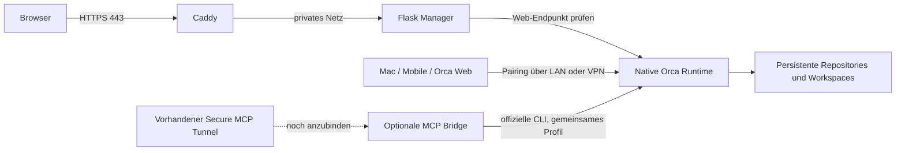

# Architektur und technische Validierung

Recherche am 24.10.2026. Originalmandat: [PROJECT_BRIEF.md](PROJECT_BRIEF.md).
Das bestehende Repository wurde weiterverwendet, nicht neu angelegt oder öffentlich gemacht.

## Komponenten

| Bereich | Entscheidung und Begründung |
| --- | --- |
| Manager | Python 3.12, Flask, Jinja, Flask-Login, Flask-WTF, Gunicorn. Serverseitiges HTML ohne SPA, Frontend-Build oder externe Fonts. |
| Auth | Ein lokaler Administrator, einmaliger Bootstrap-Token, Werkzeug-scrypt, signierte sichere Session-Cookies, 8 Stunden, CSRF, HTTPS-Referrer-Prüfung, Sperre nach 5 Fehlversuchen für 5 Minuten. Kein allgemeines Identitätsmanagement. |
| TLS | Caddy ohne Dateicapability, unprivilegierte Containerports. Persistentes, selbstsigniertes SAN-Zertifikat oder eigene Zertifikate. Kein automatischer ACME-Zwang. |
| Runtime | Orca 1.4.239, native Servervorlage aus dem offiziellen Debian-Paket, Node 24.22.1. Keine Electron-Runtime oder Desktopumgebung im fertigen Image. |
| Persistenz | Getrennte Volumes für Manager, Runtime-HOME und Workspaces. Manager erhält keinen Zugriff auf Provider-Credentials. |
| MCP | Bestehende Bridge als optionaler Container mit gleicher Runtime-CLI, gleichem HOME/Workspace und Runtime-Netzwerknamespace. Standard `status`, kein veröffentlichter Bridge-Port. |
| Restart | Compose `unless-stopped`, init-Reaper, 45 Sekunden Stop-Frist für Orca. Kein zusätzlicher `--supervise`-Prozess im Container. |
| Plattform | OCI / Docker Compose als Referenz. Debian-VM unter Proxmox als Pilot. Podman und native Proxmox-OCI/LXC separat zu prüfen. |

## Orca-Fakten und Quellen

- [Orca README](https://github.com/stablyai/orca) und
  [Release v1.4.239](https://github.com/stablyai/orca/releases/tag/v1.4.239).
  Aktuellstes Release beim Abruf. Das Release-Paket enthält Commit
  `47f77cf7018ebc0d046b82c6dde31cf704909162`; der separat gelesene Main-Stand war
  `9ebe41a763c6ea3921c499caa0d5fe4f3125f3dc`. Produktversion und
  native Artefaktversion sind unterschiedliche Angaben.
- [Remote Servers](https://github.com/stablyai/orca/blob/main/docs/site/content/docs/remote-servers.mdx):
  `orca serve`, Linux-Einstieg `orca-ide`, native orcad als Standard,
  Desktop- und Mobile-Pairing, konfigurierbarer Port 6768. `--pairing-address`
  ändert die beworbene Adresse, nicht die Bind-Adresse.
- [serve-Spezifikation](https://github.com/stablyai/orca/blob/main/src/cli/specs/serve.ts):
  `--supervise` ist für Dienstmanager gedacht und besitzt eigene Restart-Bremsen.
  Compose übernimmt hier den äußeren Lebenszyklus. `--no-pairing` verhindert
  die Ausgabe von Pairing-Zugangsdaten in Dienstlogs.
- [Artefaktvertrag](https://github.com/stablyai/orca/blob/main/src/shared/orcad-artifacts.ts),
  [Materialisierung](https://github.com/stablyai/orca/blob/main/src/main/orcad/orcad-artifact-materializer.ts)
  und [Runtime-Pin](https://github.com/stablyai/orca/blob/main/src/shared/node-runtime-pin.ts):
  Manifest-Schema 4, zielabhängige native Addons, kanonische Hash-Reihenfolge,
  Artefaktversion `0.1.0+<12-stelliger Hash>`, referenzierte Node-Runtime.
  Unser Builder prüft das Debian-Paket mit dem offiziellen SHA-512, jede
  Serverdatei mit dem enthaltenen Manifest und Node sowohl als Archiv als auch
  als ausführbare Datei gegen Orcas Runtime-Marker. Der erzeugte Inhaltshash
  wurde zusätzlich gegen Upstreams eigene `computeOrcadFullVersion`-Funktion geprüft.
- CLI und Server verwenden unterschiedliche Profilvariablen:
  `ORCA_USER_DATA_PATH` für die CLI, `ORCA_USER_DATA` für orcad. Beide zeigen auf
  dasselbe Verzeichnis. Der Healthcheck prüft `result.runtime.reachable`,
  denn `orca status` kann auch bei gestoppter Runtime mit Exitcode 0 antworten.
- Das Release enthält eine eigene Browser-WebUI, deren vorhandene Dateiliste
  unverändert übernommen wird. Der Manager ersetzt diese Oberfläche nicht.
- PTYs können einen Neustart des orcad-Prozesses überleben. Ein ersetzter
  Container beendet alle seine Prozesse: keine Garantie für weiterlaufende
  Terminals über Container-Neuerstellung. Persistente Konfiguration ist davon getrennt.

## Community-Bridge

[BuildContext/orca-mcp](https://github.com/BuildContext/orca-mcp), Version 0.3.0,
Commit `8e355dd72d168aa81c85d8003cdfeb53821f4de1`, Archiv-SHA-256 im Dockerfile.
Node ohne zusätzliche npm-Runtime-Dependencies. Ein MCP-Tool `orca` mit unter
anderem `health`, `dispatch`, `await`, `release`, `guide`, `check`, `cli`.
stdio sowie Streamable HTTP, Protokollziel 2025-11-25 laut gelesener Dokumentation.

HTTP bindet nur an Loopback. Das offizielle Bridge-Image allein enthält keine
funktionierende Orca-Installation. Deshalb leitet unser Bridge-Image von der
verifizierten Runtime ab. Gemeinsame Profile sind bewusst auf denselben
Vertrauensbereich beschränkt; es handelt sich nicht um Mandantenisolation.
Der Manager bekommt diese Profile nicht gemountet.

Upstream aktiviert standardmäßig alle Toolsets. Wir reduzieren auf `status`;
`status,dispatch` muss ausdrücklich freigeschaltet werden. Der Tunnel selbst
wird nicht nachgebaut. Sein konkretes Produkt und seine Konfiguration liegen
dem Repository noch nicht vor.

## Grenzen der Recherche und des MVP

Die offizielle Proxmox-Webquelle war aus der Cloud mit HTTP 403 nicht lesbar.
Deshalb keine behauptete Abnahme nativer Proxmox-OCI/LXC-Funktionen und keine
Annahme, dass ein Compose-Stack unverändert als einzelner LXC funktioniert.
Ein Abgleich weiterer Orca-Manager-Projekte ist noch offen; das Projekt behauptet
keine Alleinstellung. Der Frameworkentscheid basiert auf den konkreten Anforderungen.

Mac, Mobilgerät, Provider-Konten, Ziel-VM und bestehender Tunnel stehen in dieser
Cloud nicht zur Abnahme bereit. Die entsprechenden Setup-Seiten sind ehrliche
Anleitungen; sie automatisieren weder Anmeldungen noch Geräte-Pairing.
